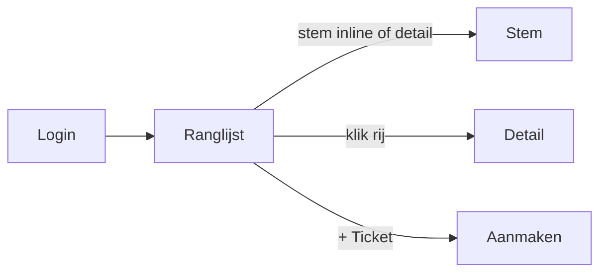
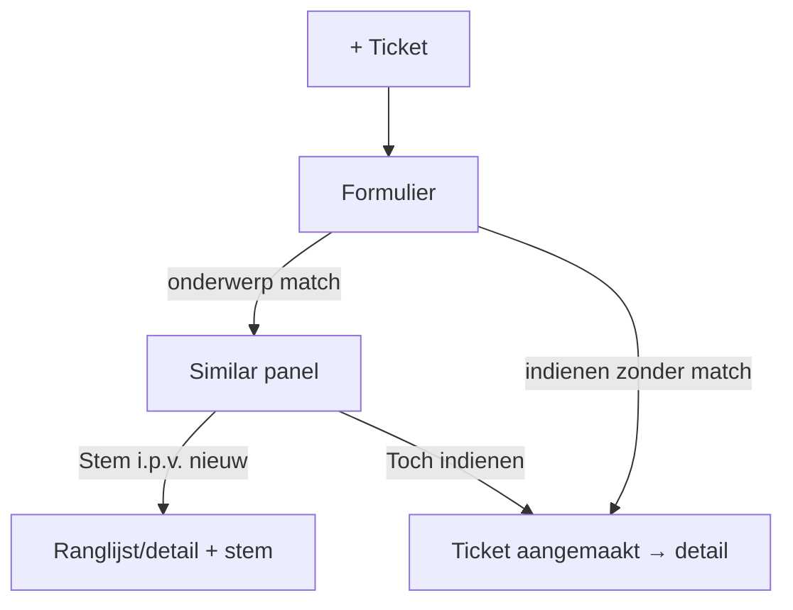
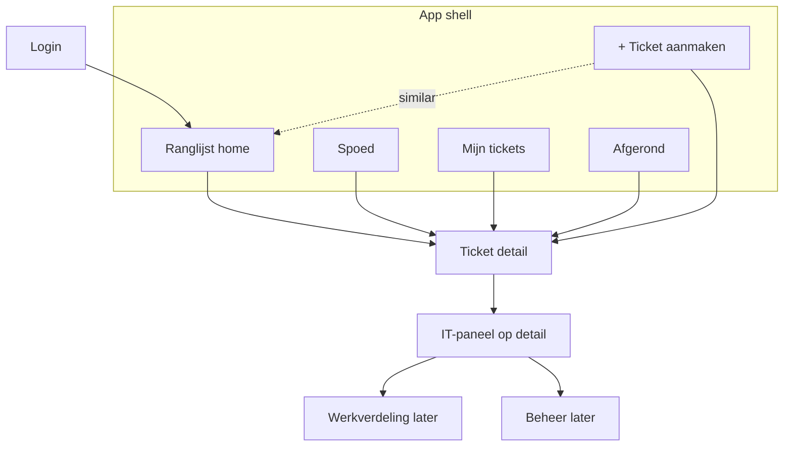

# Ticketportaal Tebi — wireframe brainstorm

> UX-structuur en layout-ideeën. Geen finale visuele design, geen code.  
> Bron: `docs/project-context.md` (Word-briefs ontbraken in de repo-checkout; inhoud is daar samengevat).  
> Parallel aan scope/MVP-plan — dit document focust op navigatie, zones en schermjobs.

---

## 1. Shared navigatie / IA

### Aanbevolen structuur (4 hoofdpagina’s + aanmaken)

| # | Pagina | Primair voor | Notitie |
|---|--------|--------------|---------|
| 1 | **Ranglijst** | Iedereen (post-login home) | NetSuite-wensen op stemmen; managers zien top-10 |
| 2 | **Spoed** | Iedereen | Storingen / urgente tickets buiten de stemranglijst |
| 3 | **Mijn tickets** | Aanvrager + IT | Eigen openstaande + betrokken tickets |
| 4 | **Afgerond** | Iedereen | Gesloten tickets / naslag |
| + | **Ticket aanmaken** | Manager (+ later gebruiker met goedkeuring) | Globale CTA, ≤3 clicks vanaf home |

**IT-only (secundair, niet in de 4-hoofdnav):**

- **Werkverdeling** — kanban / per collega (waarschijnlijk post-MVP; licht schetsen)
- **Beheer** — categorieën, systemen, stemlimieten, rollen (licht)

```
┌──────────────────────────────────────────────────────────────┐
│  TEBI  Ticketportaal          [Ranglijst][Spoed][Mijn][Afgerond]  [+ Ticket]  👤 │
└──────────────────────────────────────────────────────────────┘
         ▲ always visible primary nav              ▲ primary CTA
```

### Rolverschillen in de shell

- **Gebruiker:** nav + bekijken; stemmen op NetSuite-wensen; beperkte create (MVP: waarschijnlijk niet — zie scope-worker).
- **Manager:** + Ticket aanmaken; stemmen; afdelingszicht.
- **Uitvoerder (IT):** alles + Werkverdeling + Beheer + IT-velden op detail.

### Stemmen / stemsaldo in de chrome

Altijd zichtbaar (subtiel, niet hero): `Stemmen: 3/5 over` — alleen relevant op Ranglijst en bij NetSuite-wens/idee. Geen stem-UI bij storingen.

---

## 2. Designrichting (structuur, geen pixels)

Uit de brief: **Tebi-merk, kalm/zakelijk**.

**Structuurprincipes (geen paarse AI-slop, geen dashboard-rommel op de home):**

1. **Merk eerst in de shell** — “Tebi” + “Ticketportaal” als vaste identiteit in de topbar; geen losse marketing-hero.
2. **Eén job per scherm** — Ranglijst = stemmen/prioriteit zien; Spoed = urgente items; niet alles mengen.
3. **Lijst als anker** — primaire content is een rangorde of ticketlijst, geen card-grid van KPI’s.
4. **Kalme hiërarchie** — typografie + witruimte + duidelijke statuslabels; filters secundair.
5. **Create is dominant maar niet overheersend** — één vaste CTA `+ Ticket`; rest van de UI blijft “werkruimte”.
6. **Desktop + mobiel** — bottom-nav of compacte top-nav op mobiel; create als floating of sticky knop.

**Layout-tokens (beschrijvend):** rustige neutrale achtergrond, merkkleur als accent op CTA/active nav, statuskleuren spaarzaam (spoed vs normaal vs wacht). Geen glow, geen multi-shadow cards, geen pill-clusters.

---

## 3. Alternatieven voor Ranglijst (2–3 richtingen)

### A — Leaderboard-first (aanbevolen)

```
┌─ Topbar / nav ─────────────────────────────────────────────┐
│ Stemsaldo 3/5                    Filter: afdeling ▾  [↑↓]   │
├────────────────────────────────────────────────────────────┤
│  #  Titel              Stemmen   Systeem   Status   Stem   │
│  1  Export facturen       24     NetSuite  Open    [▲]    │
│  2  Picklijst WMS         18     …                         │
│  …                                                         │
│  (Top-10 gehighlight of apart blok “Top 10”)               │
└────────────────────────────────────────────────────────────┘
```

- **Pro:** matcht brief (“na login: ranglijst”; managers zien top-10); stemmen in ≤3 clicks (open → stem of inline stem).
- **Con:** minder “board”-gevoel; status van uitvoering zit elders (Spoed / Mijn / IT-werkverdeling).

### B — Board-first (kolommen: Ideeën → In stemming → Gepland → In uitvoering)

```
┌─ Ideeën ──┐ ┌─ Stemtop ──┐ ┌─ Gepland ──┐ ┌─ Bezig ──┐
│ cards…    │ │ #1 #2 #3   │ │ …          │ │ …        │
└───────────┘ └────────────┘ └────────────┘ └──────────┘
```

- **Pro:** status + ranking in één blik voor IT.
- **Con:** zwaar voor managers; stemmen is minder duidelijk; mobiel slecht; botst met aparte Spoed/Afgerond-IA.

### C — Split: Top-10 hero + restlijst

```
┌─ Top 10 (grote rank-nummers) ──────────────┐
│  1. …  2. …  3. …                          │
├─ Alle NetSuite-wensen (compacte tabel) ────┤
│  …                                         │
└────────────────────────────────────────────┘
```

- **Pro:** managers zien meteen top-10; rest blijft doorzoekbaar.
- **Con:** risico op “twee pagina’s in één”; op mobiel moet Top-10 inklapbaar.

### Aanbeveling

**Richting A (leaderboard-first)**, met optioneel een **compacte Top-10 samenvatting** bovenaan (lichte C-invloed) die op mobiel inklapt. Geen board op de home — board hoort bij IT-werkverdeling.

---

## 4. Schermen

### 4.1 Login

**Doel:** veilig binnenkomen; daarna direct Ranglijst.

**Zones**

```
┌──────────────────────────────┐
│         TEBI                 │
│     Ticketportaal            │
│                              │
│  E-mail                      │
│  Wachtwoord                  │
│  [ Inloggen ]                │
│  Hulp? Contact IT            │
└──────────────────────────────┘
```

- Eén kolom, gecentreerd; merk + productnaam dominant.
- Geen dashboard-preview op login.

**Componenten:** e-mail, wachtwoord (of SSO later), foutmelding, “sessie verlopen”.

**Empty/loading:** spinner op knop; inline fout (“Onjuiste gegevens”).

**Mobiel:** zelfde single-column; volledige breedte formuliervelden.

**Open UX-vragen**

- SSO (Microsoft) vs lokale login in MVP?
- Wachtwoord vergeten nodig bij interne SSO?

---

### 4.2 Ranglijst (post-login home)

**Doel:** NetSuite-wijzigingen/ideeën zien gerangschikt op stemmen; stemmen of doorklikken; snelle create.

**Zones**

1. Shell (nav + `+ Ticket` + stemsaldo)
2. Optioneel: korte uitlegregel (“Stemmen adviseren prioriteit; IT bepaalt definitief”)
3. Filters: afdeling, status, zoek
4. Leaderboard-lijst (rank, titel, stemmen, systeem, status, stem-actie)
5. Lege / geen-resultaten staat



**ASCII (desktop)**

```
┌─ TEBI Ticketportaal ─ [Ranglijst*][Spoed][Mijn][Afgerond] ─ [+ Ticket] ─ 3/5 ─ 👤 ┐
├─ NetSuite-wensen gerangschikt · Stemmen zijn advies                                  ┤
├─ [Zoek…]  Afdeling ▾  Status ▾                                                       ┤
├──────────────────────────────────────────────────────────────────────────────────────┤
│ # │ Onderwerp              │ Stemmen │ Impact │ Status      │                        │
│ 1 │ Factuurexport          │ ★ 24    │ Hoog   │ Open        │ [▲ Stem]               │
│ 2 │ …                      │ …       │ …      │ …           │                        │
└──────────────────────────────────────────────────────────────────────────────────────┘
```

**Componenten:** rank-nummer, stemteller, stemknop (disabled bij 0 stemmen of al gestemd — UX kiezen), rij → detail, filter chips (spaarzaam).

**Empty:** “Nog geen NetSuite-wensen. Maak de eerste aan.” + CTA.  
**Loading:** skeleton-rijen.  
**Geen stemmen meer:** knop disabled + tooltip “Stemsaldo op.”

**Mobiel:** lijstkaarten met `#`, titel, stemmen, grote stem-tap target; filters in sheet; Top-10 samenvatting inklapbaar.

**Open UX-vragen**

- Inline stemmen (1 click) vs alleen op detail (veiliger, meer context)?
- Mag je stem intrekken?
- Alleen NetSuite-wensen/ideeën hier — waar landen “vraag” en “wijziging” non-NetSuite? (waarschijnlijk Mijn tickets / Spoed / aparte filters — afstemmen met scope)

---

### 4.3 Spoed

**Doel:** urgente storingen / high-impact items zichtbaar zonder stemmen-ruis.

**Zones:** nav · filter (afdeling, systeem) · lijst of compacte board (Open / Bezig / Wacht) · CTA create (type vooraf “storing”?).

```
┌─ Spoed ─────────────────────────────────────┐
│ Waarschuwing: stemmen gelden hier niet      │
│ [Open 3] [Bezig 2] [Wacht op…]              │
│ • Outlook down – Verkoop     SLA 2u  [→]    │
│ • Scanner kapot – Magazijn          [→]     │
└─────────────────────────────────────────────┘
```

**Componenten:** urgentie-indicator, SLA/veroudering-signaal (later), eigenaar (IT), geen stemknop.

**Empty:** “Geen spoedtickets — mooi.”  
**Loading:** skeleton.

**Mobiel:** verticale lijst; status als badge.

**Open UX-vragen**

- Wie mag “spoed” markeren — alleen IT of ook manager bij aanmaken?
- Zit high-impact-goedkeuring hier of op detail?

---

### 4.4 Mijn tickets

**Doel:** alles waar ík aanvrager, follower of (IT) eigenaar van ben — opvolgen zonder mail.

**Zones:** tabs of segmenten `Open` / `Wacht op mij` / `Alles` · lijst · zoek/filter · create.

```
┌─ Mijn tickets ──────────────────────────────┐
│ ( Open | Wacht op mij | Alles )             │
│ • #104 Pickfout WMS     In behandeling  →   │
│ • #98  Nieuw rapport    Wacht op info   →   │
└─────────────────────────────────────────────┘
```

**Componenten:** statusbadge, laatste update, “actie vereist” highlight (bevestigen oplossing, info geven).

**Empty:** “Je hebt geen openstaande tickets.” + create.  
**Loading:** skeleton.

**Mobiel:** zelfde; “Wacht op mij” als default-segment als count > 0.

**Open UX-vragen**

- Ziet een manager ook tickets van de afdeling hier, of alleen “eigen”? (apart “Afdeling”-filter?)
- Confidential tickets: verbergen in teamfilters?

---

### 4.5 Afgerond

**Doel:** naslag, leren, “is dit al eens opgelost?” — ondersteunt latere knowledge base.

**Zones:** zoek (prominent) · periodefilter · lijst met oplossingssamenvatting · link naar detail (read-only acties).

```
┌─ Afgerond ──────────────────────────────────┐
│ [Zoek in opgeloste tickets…]  Periode ▾     │
│ #77  Printerqueue  · Opgelost 12 mrt        │
│     Oplossing: driver X herinstalleren…     │
└─────────────────────────────────────────────┘
```

**Empty:** “Nog geen afgeronde tickets.”  
**Loading:** skeleton.

**Mobiel:** zoek sticky bovenaan.

**Open UX-vragen**

- Mag je vanaf hier “heropenen” of alleen nieuw ticket + link naar oud?
- Hoeveel van de oplossingstekst tonen in de lijst?

---

### 4.6 Ticket aanmaken (≤3 clicks; similar tickets)

**Doel:** snel een goed ticket; duplicaten voorkomen door similar suggesties.

**Click-budget (voorbeeld vanaf Ranglijst)**

1. `+ Ticket`
2. Type + kernvelden invullen (onderwerp triggert similar)
3. Bevestigen / indienen  

Similar stemmen i.p.v. nieuw mag tussendoor als “click 2b”.

**Zones**

```
┌─ Nieuw ticket ─────────────────────────────────────────────┐
│ Stap/velden (één scherm, geen wizard tenzij mobiel lang):  │
│  Type: ( ) Storing  ( ) Wijziging  ( ) Vraag  ( ) Idee     │
│  Systeem: NetSuite / WMS / Hardware / Outlook / Overig     │
│  Onderwerp *                                               │
│  Omschrijving *                                            │
│  Afdeling *    Impact ▾    Bijlage                         │
│                                                            │
│ ┌─ Vergelijkbare tickets ───────────────────────────────┐  │
│ │ “Factuurexport” lijkt op #12 (24 stemmen) [Stem i.p.v.]│  │
│ └───────────────────────────────────────────────────────┘  │
│                              [Annuleren]  [Ticket indienen]│
└────────────────────────────────────────────────────────────┘
```



**Componenten:** type, systeem, onderwerp, omschrijving, afdeling, impact, bijlage (nice-to-have), similar-lijst met stem-CTA, validatiefouten.

**Empty similar:** “Geen vergelijkbare tickets gevonden.”  
**Loading similar:** subtiele “Zoeken…” onder onderwerp.  
**Success:** toast + navigatie naar detail of “nog een”.

**Mobiel:** één scrollbaar formulier; similar als sticky bottom-sheet na blur op onderwerp; type als segment control.

**Open UX-vragen**

- Verplicht bijlage? (brief: nice)
- Bij type Storing → na submit naar Spoed i.p.v. Ranglijst?
- Minimal fields voor MVP vs alle impact/size later door IT?

---

### 4.7 Ticket detail — aanvrager vs IT

**Doel:** status volgen, communiceren, (IT) plannen en afronden.

#### Aanvrager / manager view

```
┌─ #104 · Pickfout WMS ──────────────────────────────────────┐
│ Status: In behandeling     Type: Storing    Systeem: WMS   │
│ Aangemaakt door … · Afdeling … · Impact …                  │
├─ Omschrijving ─────────────────────────────────────────────┤
│ …                                                          │
├─ Updates (publiek) ────────────────────────────────────────┤
│  IT: We kijken naar de scannerconfig…                      │
│  [Reactie plaatsen]                                        │
├─ (optioneel) Bevestig oplossing [Ja, sluiten] [Nog niet]   │
└────────────────────────────────────────────────────────────┘
```

#### IT view (extra zones)

```
┌─ IT-paneel (rechterkolom desktop / sectie mobiel) ─────────┐
│ Eigenaar ▾   Streefdatum   Size S/M/L   Prioriteit (final) │
│ Status incl. wacht-states ▾                                │
│ Interne notities (niet zichtbaar voor aanvrager)           │
│ Oplossingsveld                                             │
│ [Status wijzigen] [Vraag info] [Voorstel sluiten]          │
└────────────────────────────────────────────────────────────────┘
```

**Split-layout desktop**

```
┌──────────── main (60–70%) ────────────┬──── IT rail (30–40%) ────┐
│ Header + omschrijving + publieke thread│ Alleen uitvoerder        │
└───────────────────────────────────────┴───────────────────────────┘
```

**Componenten:** status, thread (publiek vs intern), bijlagen, stemmenblok alleen bij NetSuite-wens/idee, audit (“gekoppeld aan NetSuite-change” later).

**Empty thread:** “Nog geen updates.”  
**Loading:** page skeleton.  
**Confidential:** banner “Alleen zichtbaar voor …”

**Mobiel:** IT-velden in uitklap “IT-gegevens”; tabs `Ticket` / `Updates` / `IT`.

**Open UX-vragen**

- Eén URL, role-based UI vs aparte IT-route?
- Mag aanvrager impact wijzigen na indienen?
- Notificatievoorkeur e-mail/Teams per status — op detail of in profiel?

---

### 4.8 IT werkverdeling (post-MVP, licht)

**Doel:** dagelijks werk en projecten verdelen; zicht voor IT-team (en eventueel publieke planning later).

**Zones (schets)**

```
┌─ Werkverdeling ─ [Kanban] [Per collega] [Dag vs Project] ──┐
│ To Do │ Bezig │ Wacht │ Review │ Klaar                      │
│ cards   cards   cards   …                                   │
└─────────────────────────────────────────────────────────────┘

Per collega:
┌─ Sam │ Alex │ Jordan ─────────────────┐
│ lijst openstaande + capacity hint     │
└───────────────────────────────────────┘
```

**MVP-houding:** niet in hoofdnav; IT bereikt via menu. Of vervangen door filters op Spoed + Mijn tot kanban er is.

**Open UX-vragen**

- Publieke planning read-only voor managers op welke pagina?
- Dagelijkse storingen vs projectwensen: twee boards of filter?

---

### 4.9 Beheer (licht)

**Doel:** configuratie zonder developer: lijsten, limieten, rollen.

**Zones**

```
┌─ Beheer ────────────────────────────────────┐
│ Nav-sub: Categorieën | Systemen | Stemmen   │
│          | Rollen | SLA’s (later)           │
│ Tabel + [Toevoegen]                         │
└─────────────────────────────────────────────┘
```

**MVP-simpel:** systemen + stemlimiet (bijv. 5) + roltoewijzing. Rest later.

**Open UX-vragen**

- Wie mag Beheer? Alleen lead-IT?
- Soft-delete van categorieën die op tickets hangen?

---

## 5. Mobiel — gedeelde patronen

| Patroon | Voorstel |
|---------|----------|
| Primaire nav | Bottom bar: Ranglijst, Spoed, Mijn, Afgerond; `+` center of sticky |
| Filters | Bottom sheet |
| Tabellen | Card-rijen |
| Create | Full-screen sheet |
| IT-rail | Accordion onder content |
| Stemmen | Grote tap-target; bevestiging bij laatste stem |

---

## 6. MVP-wireframes vs later polijsten

### Houd simpel in MVP-wireframes / first build

- 4 hoofdpagina’s + login + create + detail (role-based één pagina)
- Leaderboard-lijst (richting A), geen home-kanban
- Similar tickets als één panel (ook als matching simpel is)
- Stemsaldo + stemmen alleen op NetSuite-wens/idee
- Basisstatussen; wacht-states minimaal gelabeld
- Beheer: systemen + stemlimiet + rollen
- Geen bijlagen-UI verplicht; placeholder ok
- Geen reporting-dashboard, geen knowledge base, geen mail-intake UI

### Later polijsten / post-MVP

- IT kanban + per collega + dag/project-split
- Top-10 visuele highlight / print/export voor management
- SLA-timers, stale signals, high-impact approval flows
- Interne vs publieke comments + Teams/mail templates
- Afdelingsviews, confidential, requester confirm-close
- Bijlagen, weekoverzicht, NetSuite deep links, self-submit + approval
- Rijkere similar-matching en “stem i.p.v. nieuw”-funnel analytics

---

## 7. Navigatiekaart (samenvatting)



---

## 8. Aanbevelingen (kort)

1. **IA:** Ranglijst · Spoed · Mijn tickets · Afgerond + globale `+ Ticket`; IT-werkverdeling en Beheer buiten de hoofdnav.
2. **Ranglijst:** **leaderboard-first (A)**, eventueel compacte inklapbare Top-10; geen board op de home.
3. **Create:** één scherm + similar panel; doelpad ≤3 clicks vanaf home.
4. **Detail:** één route, IT-rail alleen voor uitvoerders.
5. **Toon:** kalm, merk in de shell, lijstgedreven — structuur boven decoratie.
